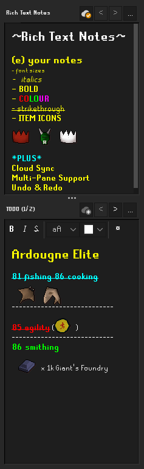
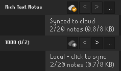

# Rich Text Notes

Rich Text Notes is an enhanced version of the built-in "notes" plugin.

It includes a number of features you might find in a full-fledged text editor like:
* Font Size
* Bold, Italics, Strikethrough
* Tabs
* Multiple Editor Panes
* Item Icon "Emoji"
* Save, Load, and Tag notes for management
* Cloud Sync between computers with your RuneLite Account

To make a new note click `...` -> `New Note`

----------------
## CLOUD SYNC

Click the cloud button on a note to sync it through your RuneLite account.

* You need to be logged in to RuneLite with cloud sync enabled on your profile
* Up to 20 notes, 8 KB each
* Notes sync when RuneLite starts or you switch profiles
* If a note was changed on two computers and the sync fails, the other version is saved as `(conflict)`

----------------
## CONTROLS

- `Ctrl + C | Copy`
- `Ctrl + V | Paste`

- `Ctrl + Z | Undo`
- `Ctrl + Y | Redo`

- `Ctrl + I | Italic`
- `Ctrl + B | Bold`
- `Ctrl + Shift + S | Strikethrough`

----------------

* Notes are saved in `.runelite/rich-text-notes`. Synced notes are saved to your RuneLite profile
* To find your notes click `...` -> `Open Notes Directory`
* Notes from old versions can be found in `backups/before-v2`
